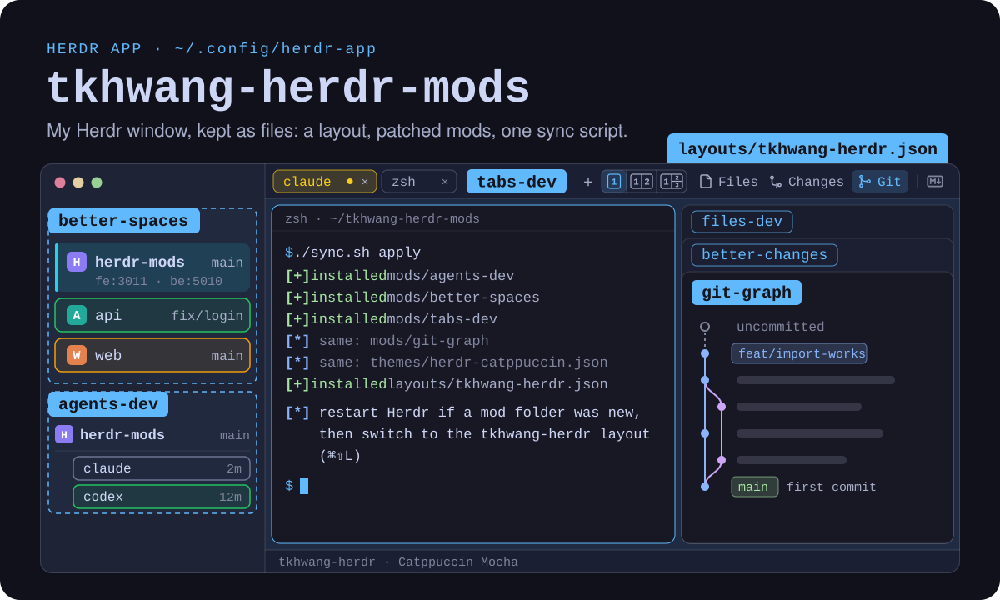

<p align="center">
  
</p>

My [Herdr app](https://herdr.dev/core/) window, as files: my layout and config, the Herdr and open-source mods it uses kept exactly as their authors ship them, my changes to each kept apart as one patch per mod, and the few files I wrote myself. `sync.sh` puts them together and installs them. Moved here from [tkhwang-dotfiles](https://github.com/tkhwang/tkhwang-dotfiles).

## Quick start

```bash
git clone https://github.com/tkhwang/tkhwang-herdr-mods.git
cd tkhwang-herdr-mods
./sync.sh apply
```

After a first `apply`, restart Herdr (it sees new mod folders at start) and pick the `tkhwang-herdr` layout with ⌘⇧L, or run `herdr-app do layout.switch '{"name":"tkhwang-herdr"}'`. Every file `apply` replaces is moved to `~/.config/herdr-app.bak-<time>-<pid>/` first.

## What it changes

| Where | What you get |
| --- | --- |
| **Spaces list**<br>`better-spaces` | branch and PR status per space, nested worktrees, workbranch tasks named after their repo with its branch (one repo) or their task folder with the project and only what differs (several repos), dev server ports, agent status marks as media buttons (a blue play ▶ on a pale blue row while an agent works, an orange pause ❚❚ that breathes on a pale orange row when one needs you, a green stop ■ when one is done), the current space in a pale neutral tint with a bold name and a bar on the left in the text color |
| **Agents list**<br>`agents-dev` | agents grouped under their space, nested rows, workbranch tasks named as in the Spaces list, the repo an agent is in for a multi-repo task, the same status colors and highlight |
| **Tab bar**<br>`better-tabs` | tabs that wrap onto more lines and drag to reorder, then at the right `+`, the window switch, and **Files**, **Changes** and **Git** buttons that drag too or tuck into a ⋮ menu; each space's open panel remembered |
| **Window switch**<br>`tkhwang-view-mode` | a [1] \| [1\|2] \| [1\|2/3] switch between `+` and Files: the shown tab's main window alone, with one window beside it, or with two stacked beside it |
| **Side panel, Files**<br>`file-icons` | the focused pane's folder as a tree with VS Code's Material Icon Theme icons, git letters and a read-only preview; a Markdown file opens in the Markdown tab instead |
| **Side panel**<br>`better-changes`, `git-graph` | Changes and Git show one folder, the tab's first pane (its main window), or a pane or folder picked in the folder bar under each panel's header; the focus no longer moves them |
| **Side panel, Changes**<br>`better-changes` | staged/unstaged groups, diffs, a repo picker in workbranch wrappers, AI commit messages, a Push button, the Files panel's Material icons; a Markdown file opens in the Markdown tab instead of the diff tab |
| **Center, Markdown tab**<br>`tkhwang-markdown` | a Markdown file clicked in Files or Changes, in a tab of its own with **View** \| **Diff** \| **Edit** in its header: formatted, what changed since the last commit, or its source, saved as you type and never over a change made meanwhile |
| **Side panel, Git**<br>`git-graph` | a commit graph, or a Manygit list in a folder of repos |
| **Terminal**<br>copy-on-select | copies a selection on mouse release |
| **Theme**<br>Catppuccin | Mocha in dark mode, Latte in light mode, a `#60b9fc` accent |

`tabs-dev`, `spaces-dev`, `changes-dev` and `files-dev` stay installed as fallbacks: put one back in the layout's tabs, spaces, changes or files block to switch. `files-dev` was the Files panel before `file-icons`; back in the files block, Files shows the folder Changes and Git show again, with the folder bar. `tabs-dev` was the tab bar before `better-tabs`, and what only it opens isn't reachable from `better-tabs`: the **Open with Zed** `+` menu (`herdr-open-with-zed`) and the Markdown icon, which opens the Markdown tab on the file `files-dev` or Changes is on. Its window switch moved out into `tkhwang-view-mode`; with `tabs-dev` back, take the layout's `view-mode` block out, or both switches fold windows.

## How this repo is organized

Other people's code and mine are kept apart, so it is always clear what I changed, and an upstream release can be taken without redoing my changes by hand.

| Folder | Whose | What |
| --- | --- | --- |
| `upstream/<mod>/` | theirs | the mod as its source ships it, at the commit `sources.json` pins; never edited by hand |
| `upstream/<mod>.extra/` | theirs | single files taken into that mod from another repo (`navigation.js` from filipores/herdr-spaces-status; `lookup.js` and `icons.js` from file-icons) |
| `patches/<mod>.patch` | mine | everything I changed in that mod, as one diff against its upstream |
| `own/shared/` | mine | files several mods carry the same copy of: `panel-folder.js`, `markdown.js`, `ports.js`, `play.svg`, `pause.svg`, `stop.svg` |
| `own/mods/<mod>/` | mine | mods written from scratch: `tkhwang-view-mode`, `tkhwang-markdown` |
| `config/` | mine | `layouts/tkhwang-herdr.json`, `settings.json`, `keys.json` |
| `licenses/<source>/` | theirs | each source's `LICENSE` and `NOTICE`, as shipped at the pinned commit; `NOTICE-<commit>` beside it while mods from one source are pinned at different commits |
| `sources.json` | | where each mod comes from: repo, path, commit (and tag), license, extra files, shared files |

```
upstream/<mod>/ ─────────┐
upstream/<mod>.extra/ ───┤
patches/<mod>.patch ─────┼─ build ─▶ build/mods/<mod>/ ─ apply ─▶ ~/.config/herdr-app/mods/<mod>/
own/shared/<file> ───────┘                                                     │
patches/, own/, config/ ◀──────────────────── backup ─────────────────────────┘
```

Each mod in `sources.json` has a `kind`:

- `herdr`: a clone of one of Herdr's own mods, from [herdrdev/herdr-app](https://github.com/herdrdev/herdr-app)'s `defaults/mods/` at the version it was cloned from (`cloned_from` in its `mod.json`).
- `oss`: someone else's open-source mod, kept here with its license.
- `fetch`: an open-source mod with no license, so not kept here: `apply` downloads it at the pinned commit.
- `own`: a mod in `own/mods/`.

The themes have no license either: `apply` downloads them at the pinned commit and checks each one's sha256.

## Commands

```bash
./sync.sh status                   # each mod: where it's from, my patch's size, whether the app has this build
./sync.sh backup                   # ~/.config/herdr-app -> patches/, own/, config/
./sync.sh apply                    # build, then install into ~/.config/herdr-app
./sync.sh build                    # only put the mods together, into build/mods
./sync.sh update <mod> <ref>       # take a new upstream version (a tag, a branch or a full commit), keeping my patch
./sync.sh update <mod> --continue  # finish an update after fixing what it couldn't merge, in work/<mod>/
```

**Day to day.** Change a mod or the layout in the app, which reloads at once, then `./sync.sh backup` and commit. The commit shows my change and nothing else: `backup` rewrites each mod's patch against its upstream and puts the shared files back in `own/shared/`. It stops, changing nothing, if the copies of a shared file in the app differ.

**Taking an upstream release.** `./sync.sh update git-graph v0.4.0` merges three ways, file by file: the old upstream, the old upstream with my patch, and the new upstream. When everything merges it moves `upstream/git-graph/` to the new version, rewrites the patch on top of it and records the commit (and tag) in `sources.json`; `./sync.sh apply` then installs it. A file changed in the same place on both sides keeps conflict markers in `work/git-graph/`: fix it there, then `./sync.sh update git-graph --continue`. If upstream moved the mod to another folder, change its `path` in `sources.json` first.

For a Herdr clone the ref is a Herdr version tag: `./sync.sh update agents-dev v0.1.13`. Herdr's `mod.clone` renamed the clone's own asset paths (`mods/agents/…` to `mods/agents-dev/…`) and my patch carries that, but new code from Herdr names `mods/agents/…`: look for those after an update.

**What apply does.** It copies, never links: the app rewrites the layout file as the window is used. Each changed mod is staged beside the app folder, so the app never loads a partial mod, and checked with `herdr-app check` before any goes in; if one fails, nothing is installed. Every file it replaces is moved to `~/.config/herdr-app.bak-<time>-<pid>/` first. Mods that `sources.json` doesn't name are left alone by every command. `sync.sh` needs `jq`, `git`, `rsync`, `curl` and `shasum`, all on macOS.

## Before you apply

- **What runs, and what reaches the network.** `better-spaces` runs `git`, `hc` and `gh` (GitHub with your local `gh` login). The sparkle **Message** button in `better-changes` runs `claude -p`, so the staged diff goes to Anthropic through your Claude Code login, and its Push button runs `git push` with your git credentials. `git-graph` reaches the network only on Fetch, Pull, Push or deleting a remote branch, and asks GitHub's releases API once a day for a newer release. `markdown-browser` uses no network. `file-icons` runs `sh` to list folders and `git` to read status, on the space's machine, and uses no network. `tkhwang-markdown` runs `git` only to read (the Diff view, on the file's machine), writes only the file you edit in it, and uses no network.
- **Workbranch wrappers.** In a folder of repos that is not a repo itself, `better-changes` and `changes-dev` show a repo picker, `git-graph` shows a Manygit list, and `better-spaces` and `agents-dev` name a workbranch task space (a `.workbranch.task` file beside its repos, or a folder of repos right under a project's `.workbranch.config` other than `_base`) after its repo with the branch under it when it holds one repo, and after its task folder when it holds several, since those repos are the same in every task; there `better-spaces` shows the project under the name and a repo's branch only when it isn't the task's (no PR status for a task folder). A plain folder of repos and a project's own folder keep their names.
- **Theme picks.** A theme picked in Settings > Look is kept per layout in `layouts/.state/`; pick the Catppuccin themes there again if one was picked before.
- **Command time limit.** Herdr stops a command after 30 s, so a slow fetch or push in `git-graph` can fail.

## Mods

Each change is also marked with a comment in the code, so `grep -n "status mark" patches/better-spaces.patch` (or the same in `build/mods/better-spaces/`) finds every line of it.

### Mine: config, shared files and my own mods

In `config/` and `own/`.

<details>
<summary><b><code>config/layouts/tkhwang-herdr.json</code></b> · the window</summary>

Clone of the shipped `main` layout; its spaces block points to `better-spaces`, its agents block to `agents-dev`, its Files block to `file-icons`, its Changes slot to `better-changes`, its tab bar to `better-tabs` (its Files, Changes and Git buttons in the block's `props`), a 0px `view-mode` block at the bottom to `tkhwang-view-mode` (beside copy-on-select's), and its side panel (`panel-body`) has a third block, `graph`, for `git-graph`. Its theme is Catppuccin: `herdr-catppuccin` (Mocha) in dark mode, `herdr-catppuccin-latte` in light mode.

</details>

<details>
<summary><b><code>config/settings.json</code>, <code>config/keys.json</code></b> · app look and keys</summary>

App look and keys; `keys.json` also carries markdown-browser's `mod:markdown-browser` section (`⌘⇧O`).

</details>

<details>
<summary><b><code>own/shared/panel-folder.js</code></b> · one folder for Files, Changes and Git</summary>

**Marker:** `panel folder`, in `files-dev`, `better-changes` and `git-graph`

With `file-icons` in the Files block (it has no folder bar and follows the focused pane), only Changes and Git share the folder; `files-dev` joins them again when it is back.

The shipped panels follow the focused pane, each on its own, so a click on a second or third pane, or the tab bar's view switch moving the focus, moved Files, Changes and Git to other folders. The three now show one folder for the shown tab, whatever has the focus: its main window's, the tab's first pane, which the tab bar's 1 shows.

A folder bar under each panel's header has a chip for each folder the tab's panes are in, numbered by the first pane there and with its branch, and **Folder…**, which picks any folder on this machine in the system's folder picker (not in a space on another machine). The lit chip is the folder all three show. A click on another chip lights it in all three for that tab, until another pick: a picked pane is followed as it changes folder, and once it closes the main pane is back. Picks are kept by tab in the shared `panel-folder.picks`. The Changes diff tab and the Markdown tab have no bar and keep the folder they were opened from.

Herdr can list an agent's terminal in a folder other than the one the agent works in; **Folder…** shows the right one then. It is one file, `own/shared/panel-folder.js`, that `sync.sh` copies into all three mods. Edit it in any of them in the app: `backup` takes it back, and stops if the three copies differ.

</details>

<details>
<summary><b><code>own/mods/tkhwang-view-mode</code></b> · [1] | [1|2] | [1|2/3] window switch</summary>

What a switch for the shown tab's main window, its first pane, and its secondary windows does. It was `tabs-dev`'s `view mode` lines, moved out of the tab bar. The tab bar draws the switch, between `+` and Files (`better-tabs`' `view mode` lines, below): each button is a small picture of the windows it shows, numbered as the folder bar numbers them, the mode you are in is lit, and a click sends the mode to this mod as `tkhwang-view-mode.1`, `2` or `3`. This mod draws nothing and sits in an empty 0px `view-mode` block at the bottom of the layout, as copy-on-select does. It does what `tabs-dev` did:

- **1** zooms the main window so the secondary ones fold away, still running, and the side panel keeps its room, also when switching tabs and when an agent starting or ending in the shown tab changes whether it folds. It folds a tab of main and one or two secondary windows, or one with more windows and an agent; one with more windows and no agent (`herdr-dev.sh`'s four-pane dev tab) keeps them all, on a click on 1 too.
- **2** shows main and one secondary window side by side; a click on 2 in a tab with only its main window splits it down the middle for a shell in main's folder. 2 puts a tab's third window away instead of closing it: its terminal keeps running without a pane (`terminal.park`), unless an agent runs there.
- **3** shows main and two secondary windows stacked on its right; a click on 3 makes the ones a tab lacks, and first puts back the shell 2 put away (`terminal.keep`), so 3 → 2 → 3 keeps its history. Closing a tab ends the shells put away from it.

On their own the modes never touch a zoom done by hand, and a pane split in while a tab is folded stays in view; a click on any button, the lit one too, puts the shown tab in that mode (2 and 3 unzoom any pane). `herdr-app do tkhwang-view-mode.1` (or `2`, `3`; also `mobile`, `desktop`, `triple`) does what a click does, so a key in `keys.json` can too; none is bound. Another tab bar can have the switch by sending the same commands and lighting the shared mode.

The mode, the panes 1 zoomed and the shells 2 put away are the shared `tkhwang-view-mode.view`, `tkhwang-view-mode.zoomed` and `tkhwang-view-mode.parked`; the first start takes over `tabs-dev`'s `tabs-dev.view*` once, so its mode and folds carry on. It looks at the shown tab right after each render instead of during it, so it never runs a command while the window draws.

</details>

<details>
<summary><b><code>own/mods/tkhwang-markdown</code></b> · the Markdown tab: View | Diff | Edit</summary>

**Marker:** `markdown tab`, in `file-icons`, `better-changes`, `files-dev` and `tabs-dev`, with `own/shared/markdown.js`

A click on a Markdown file (`.md`, `.mdx`, `.markdown`) in Files (`file-icons`) or Changes (`better-changes`) shows it in the center, in a tab of its own named after the file, instead of Files' small read-only preview or the Changes diff tab. Each space has one such tab, reused in place: a click on another Markdown file switches it to that file and selects it. A file deleted in Changes still opens the diff tab, since there is nothing left to show or edit.

The header, 44 px under the pane's own, shows the file's Material icon (from `file-icons`), its name over its folder (`~/…`, or `machine: folder` for a space on another machine), then **View** | **Diff** | **Edit** as one control with the shown mode lit, the saving state ("Edited", "Saving…", "Saved"; "Read only" for a file on another machine; "Too large to edit" past 400,000 characters), Read again and Close. A click in Files opens it on View, one in Changes on Diff; the header switches from there, as do `tkhwang-markdown.view`, `.diff`, `.edit` and `.save` (`herdr-app do`, or a key in `keys.json`; none is bound).

- **View** draws the file formatted with Herdr's `TextView.markdown`, at most 920 px wide, selectable; YAML front matter shows as a `yaml` code block and MDX's top-level `import`/`export` lines are left out. It shows what is in Edit, saved or not. A link to another Markdown file opens it in the same tab; an `http(s)` link in the browser. Images and Mermaid aren't drawn (`TextView` doesn't).
- **Diff** is what changed since the last commit: `git diff HEAD` of the file, in its folder on its machine, as one column with both line numbers, added lines green and removed red, and `+N −M` with the repository over it. A file Git doesn't have yet, or a repository with no commit, shows the whole file as added; a file outside a repository says there is nothing to compare it with. Cut to 3,000 lines of 4,000 characters.
- **Edit** opens the whole file as Markdown source in Herdr's editor (line numbers, soft wrap). Its colors are partial: Herdr's editor (`syntax.rs`) turns only code scopes into colors, so the Markdown marks (`#`, `**`, `` ` ``, `-`, `>`, `[ ]( )`, fences) show in the theme's accent, a fence's language name and a link title in their own colors, and the text of headings, emphasis, inline and fenced code, and URLs plain. What you type is saved 0.7 s after you stop and on ⌘S (Ctrl+S elsewhere), with `writeTextFile` only over the file as it was last read; leaving Edit, showing another file and closing the tab save first. When the file changed on disk meanwhile (an agent wrote it), nothing is written: a bar says so, with **Keep mine** (writes yours over it) and **Take the file's** (drops yours); another file asked for meanwhile opens after you choose. A file on another machine can be read, not saved (`writeTextFile` writes here only).

The file is read again whenever its folder changes (`watchFolder`), and every 3 s on another machine, so an agent writing it shows up as it writes; while you have unsaved text the change waits for your choice as above.

`own/shared/markdown.js` opens the tab, and `file-icons`, `better-changes`, `files-dev` and `tabs-dev` carry the same copy: `showMarkdown({ file, on, cwd, mode })` opens or reuses the space's tab with `tab.new {mod: "tkhwang-markdown"}`, records it in the shared `markdown-tab.tabs` (`{ space: { tab, slot, cwd, on } }`) and what it shows in `tkhwang-markdown.show` (`{ slot: { file, on, mode, at } }`; a newer `at` is another click); `markdownTab(space)` and `markdownShown(space)` tell the panels which tab it is and which file it shows. While the tab is shown, Files, Changes and Git keep showing the folder the file was opened from (`cwd`), and Files lights the file's row.

</details>

### Herdr's own mods, changed

`kind: herdr`: `upstream/<mod>/` is the shipped mod at the version it was cloned from, `patches/<mod>.patch` my change.

<details>
<summary><b><code>agents-dev</code></b> · Agents list · clone of Herdr's <code>agents</code> 0.1.11</summary>

**Markers:** `space headers`, `status mark`, `current highlight`, `nested rows`, `wrapper repos`, `sidebar size`

"Grouped by space" headers with the space's colored initials (as the Spaces list draws them; marked `space initials`), bold name and separators, without ahead, behind or PRs (the Spaces list shows a space's git state, the Agents list who works where); patch marked `space headers`. Until a sort is picked it groups by space (the shipped default is Priority, which has no space headers); the pick is kept by the app, not in this repo.

Each agent row keeps Herdr's status at its right end, drawn as the Spaces list's media buttons (`play.svg`, `pause.svg`, `stop.svg`, the same files as in `better-spaces`): a still blue play ▶ while working, an orange pause ❚❚ that breathes when it needs you (Herdr wrote **Needs you**), a green stop ■ when done, and Herdr's ring when idle, in the Spaces list's colors: needs you orange (`#f97316`), done green (`#22c55e`) (marked `status mark`). Rows take the Spaces list's backgrounds (marked `current highlight`, `status mark`): an agent that needs you pale orange, a working agent's row pale blue, the focused agent's a pale neutral tint with a bold name and the text-color bar on its left edge, and a focused agent that needs you or works a deeper orange or blue with that bar; no outline on any row.

Under a space header each agent row, and its sub-terminal rows, steps in 22px (the header's avatar and gap, the depth the Spaces list nests a worktree at), so the space reads as the heading and its agents as the items under it; pinned and priority rows, which name their space themselves, stay at the edge (marked `nested rows`; the `NEST` constant sets the depth).

A workbranch task space's header is named and lettered as in the Spaces list: a task of one repo after the repo, with its branch on a line under the name (it says which task), a task of several after its task folder; in a task of several repos an agent's row names the repo its folder is in (`backend`; nothing at the task's own folder), read from `better-spaces`' shared `better-spaces.wrappers` (marked `wrapper repos`).

The layout's `agents` block props size the list the same way as the Spaces list's, in the interface font (marked `sidebar size`; `fs` and `rowPx` at the top of `main.js`): `font_size` stands for the 13 px the shipped list is drawn at and every text size scales with it (12 here), and `row_scale` multiplies every row and header height (0.85 here). Without them it keeps the shipped sizes, which don't follow the interface text size. The sort menu, an overlay with its own props, keeps them too.

</details>

<details>
<summary><b><code>tabs-dev</code></b> · fallback tab bar · clone of Herdr's <code>tabs</code> 0.1.11</summary>

**Markers:** `open with zed`, `tab width`, `tab kind`, `git graph`, `markdown browser`, `view mode`

Replaced in the layout by `better-tabs` and kept as the fallback: put `tabs-dev` back in the layout's `tabs` block to switch. Its `view mode` lines (the window switch below) also live on as `own/mods/tkhwang-view-mode`, under its own shared keys: with `tabs-dev` back, take the layout's `view-mode` block out.

Clone of the shipped tab bar whose `+` button opens `herdr-open-with-zed` (one row taller, 543px); patch marked `open with zed`. Each tab is at least 180px wide, so a short name is still easy to click, with the status dot and close button at its right edge (marked `tab width`).

A tab with an agent in any of its panes is tinted yellow (`#facc15`), the color that stands out most since agent tabs matter most, while other tabs keep the theme's grey and are always outlined in the theme's foreground at 25% (40% when active, also filled), since the shipped tab bar draws inactive tabs as bare text and the theme's own border color almost vanishes against the bar (marked `tab kind`).

A **Git** button beside Files and Changes opens `git-graph` in the same side panel (marked `git graph`; the panel's `graph` block is in `config/layouts/tkhwang-herdr.json`).

A Markdown icon after **Git**, past a thin line (an icon alone, since it is used less than Files, Changes and Git; its tooltip names it), shows the Markdown file the open panel is on (Files' preview, or the file picked in Changes) in the Markdown tab in the center (`tkhwang-markdown`, above), one per space, switched in place on the next click and lit while that tab is shown; it stays dim until a Markdown file is picked (marked `markdown browser`; `markdown.js`, shared `markdown-tab.tabs` and `tkhwang-markdown.show`). The icon is `markdown-browser`'s.

Right of `+`, a [1] | [1|2] | [1|2/3] switch for a tab's main window, its first pane, and its secondary windows: each button is a small picture of the windows it shows, numbered as the folder bar numbers them. 1 zooms the main window so the secondary ones fold away, still running, and the file panel keeps its room, also when switching tabs and when an agent starting or ending in the shown tab changes whether it folds. 2 shows them side by side, and a click on 2 in a tab with only its main window splits it down the middle for a secondary shell in main's folder. 3 shows main and two secondary windows stacked on its right, and a click on 3 makes the ones a tab lacks: main alone is split down the middle, then the second window is split across for a third, each a shell in main's folder; a tab of two gets only the third, under its second window. Neither 2 nor 3 moves the windows a tab already has, so 3 gives the pictured shape only to a tab of main alone or of main and one window on its right: two windows stacked one over the other become three stacked. 2 puts a tab's third window away instead of closing it: its terminal keeps running without a pane (`terminal.park`), and 3 puts that same shell back under the second window (`terminal.keep`), so 3 → 2 → 3 keeps its history; a new one is made only when there is none to put back. A third window running an agent stays in view, since put away its status would leave the tab and the agent lists. Like 1's folding, putting away and back also happens when switching tabs, never on a split or an agent starting; closing a tab ends the shells put away from it. 1 folds a tab of main and one or two secondary windows (what 2 and 3 make), or one with more windows and an agent; one with more windows and no agent (`herdr-dev.sh`'s four-pane dev tab) keeps them all, on a click on 1 too, and a zoom 1 left there comes undone when it is shown. On their own the modes never touch a zoom done by hand, and a pane split in while a tab is folded stays in view. A click on any button, the lit one too, puts the shown tab in that mode: 2 and 3 unzoom any pane, and 1 folds a tab it folds (above) to its main window, moving a zoom done by hand (marked `view mode`; shared `tabs-dev.view`, `tabs-dev.view-zoomed` and `tabs-dev.view-parked`).

</details>

<details>
<summary><b><code>files-dev</code></b> · fallback Files panel · clone of Herdr's <code>files</code> 0.1.13</summary>

**Markers:** `markdown tab`, `panel folder`

Replaced in the layout by `file-icons` and kept as the fallback: put `files-dev` back in the layout's `files` block to switch.

Clone of the shipped Files panel (0.1.13). It publishes the file its preview shows as the shared `files-dev.shown`, so `tabs-dev`'s Markdown icon can show it (unused with `better-tabs`), and while the Markdown tab is the shown one it keeps listing the folder the file came from instead of jumping to the space folder (marked `markdown tab`; `markdown.js` is the same file as in `tabs-dev`).

It lists the folder Changes and Git show too, with the folder bar under its header, instead of the focused pane's, and in the Changes diff tab it stays on the diff's repository (marked `panel folder`; `panel-folder.js`, below).

</details>

<details>
<summary><b><code>spaces-dev</code></b> · fallback Spaces list · clone of Herdr's <code>spaces</code> 0.1.11</summary>

**Markers:** `dev ports`

Dev server ports under each space (`🧑 fe:3011 · be:5010`, `🤖` for agent-started servers), read from the files `herdr-dev.sh watch` writes (see [`scripts/projects/fullstack-multi-repo/`](https://github.com/tkhwang/tkhwang-dotfiles/tree/main/scripts/projects/fullstack-multi-repo) in tkhwang-dotfiles); patch: `own/shared/ports.js` (`better-spaces` carries the same file) and lines marked `dev ports`. Replaced in the layout by `better-spaces` and kept as the fallback.

</details>

<details>
<summary><b><code>changes-dev</code></b> · fallback Changes panel · clone of Herdr's <code>changes</code> 0.1.11</summary>

**Markers:** `wrapper repos`

In a workbranch wrapper folder (not a repo, repos right under it such as `backend/` and `frontend/`) a repo picker with per-repo change counts; commits go to the picked repo; patch marked `wrapper repos`. Unlike `better-changes` it follows the focused pane, not the folder bar.

</details>

### Open-source mods, changed

`kind: oss` with a patch.

<details>
<summary><b><code>better-spaces</code></b> · Spaces list · <a href="https://github.com/munza/herdr-mods/tree/main/better-spaces">munza/herdr-mods</a> at <code>77d94f7</code>, patched</summary>

**Markers:** `dev ports`, `space colors`, `status mark`, `current highlight`, `wrapper repos`, `sidebar size`

[munza/herdr-mods](https://github.com/munza/herdr-mods/tree/main/better-spaces) at `77d94f7` (branch right-aligned on the space row, worktrees nested, PR status from `gh`), in the spaces block. Patched with the same `dev ports` line (`ports.js` and lines marked `dev ports`), and `updateColors` waits up to 2 s after a start for the shared `space.colors` (marked `space colors`): without that its first tick recolored every space. It runs `git`, `hc` and `gh` (GitHub with your local `gh` login). A space whose first terminal is in a workbranch task folder (not a repo: a `.workbranch.task` file beside the repos it holds, such as `feature-cpq-task-a/backend` and `feature-cpq-task-a/frontend`, or, for a task made before that file, a folder of repos right under the project's `.workbranch.config` other than its `_base`), or in a repo right in one, takes the row's width (nothing beside the name) and one dim line under it. A task of one repo is named after the repo (`tkhwang-herdr-mods`), and the line shows the repo's branch (`feat/update-1105-part2`), ahead and behind: the repo first, then the branch that says which task. A task of several repos is named after the task folder (`feature-cpq-task-a`), since its repos are the same in every task, and the line shows the project (`PROJECT_NAME` in `.workbranch.config`) and only the repos with something to say, by name: a branch other than the task's, ahead and behind. A branch other than the task's is yellow in both: the task file's `REPO_BRANCH`, else the folder name with `-` read as `/`, which is how workbranch names the folder. Every repo's branch is in that line's tooltip; the project, task and folder in the name's. A space the person named keeps its name, with the repo's name before a lone repo's branch. The tasks are published as the shared `better-spaces.wrappers` for the Agents list (marked `wrapper repos`; `TASK_INFO`, `better-changes`' repo loop behind the task check, at most 6 repos, read every 15 s while the window is active and after a command ends in the space). No PR status for a task folder.

Also merged in: the navigation of [filipores/herdr-spaces-status](https://github.com/filipores/herdr-spaces-status) at `4881e68` (`navigation.js`; commands `better-spaces.first_done` and `better-spaces.next_working`, no keys bound; marked `status mark`), Apache-2.0 ([`licenses/herdr-spaces-status/LICENSE`](licenses/herdr-spaces-status/LICENSE), [`licenses/herdr-spaces-status/NOTICE`](licenses/herdr-spaces-status/NOTICE)). Its own `spaces-glow` mod isn't installed: it replaces the same Spaces block and would drop the branch, PR and port lines. Each space row ends in one status mark, for the most urgent of its agents as Herdr ranks them (marked `status mark`; `statusMark` in `main.js`): media buttons that read as one set (`play.svg`, `pause.svg` and `stop.svg`, the same files as in `agents-dev`, 12 px): needs you, an orange pause ❚❚ (`#f97316`) that breathes (stopped for you), on a pale orange row: the most urgent state gets the strongest mark, and it wins over working when a space has one agent of each (`rowState`); done, a green stop ■ (`#22c55e`); working, a play ▶ in the theme's working blue, still, and the row a pale working blue (`rowTint`), since a mark at the right end alone was easy to miss; idle, nothing. The slot is there on every row, so the branches line up. In the narrow rail the mark takes the PR badge's place. There is no outline or fill on a row: the current space alone has a background.

A space's avatar shows the first letters of its name's first and last words (`tkhwang-herdr-mods` TM, `feature-cpq-task-a` FA, `workbranch` W; marked `space initials`), as does its header in the Agents list: one letter came out the same for most spaces of one project or owner.

The active space row has a pale tint of the text color (18 %, stronger than a hover's 10 %, and shown in light themes too) a bold name and a 3 px bar on its left edge in the text color (marked `current highlight`; `currentBar`), so where you are reads at a glance whatever the background; when its agent needs you or works, the tint is a deeper orange or working blue instead. Rows are 3 px apart, so two rows with a background read as two, not one block. So the theme's working blue means working alone: before, the current row's cyan was the biggest blue area and drowned the working marks.

The layout's `spaces` block props size the list, in the interface font (marked `sidebar size`; `em` and `rowPx` in `typography.js`): `font_size` is the px every text size scales from (12 here; without it, the interface text size), and `row_scale` multiplies every row height (0.85 here; without it, 1: a space row 30 px, a worktree row 28 px, its PR, task and port lines). Icons and avatars keep their size.

</details>

<details>
<summary><b><code>better-changes</code></b> · side panel, Changes · <a href="https://github.com/munza/herdr-mods/tree/main/better-changes">munza/herdr-mods</a> at <code>77d94f7</code>, patched</summary>

**Markers:** `wrapper repos`, `commit box`, `ai message`, `push button`, `markdown tab`, `panel folder`, `changes font`, `file icons`

[munza/herdr-mods](https://github.com/munza/herdr-mods/tree/main/better-changes) at `77d94f7` (staged/unstaged groups with stage buttons, tree/flat list, inline/side-by-side diff in one reusable tab), in the Changes slot. Patched with the same `wrapper repos` repo picker (it commits staged changes of the picked repo only), and `mod.json` `place` is `none` so it doesn't also dock a second right sidebar. The commit message is a text area (3 to 8 rows) with the buttons under it, Message, Commit and Push filling the row 1 : 2 : 1 (marked `commit box`; `BUTTON_WEIGHTS` at the top of `main.js`). They keep their look while the panel rereads git (every 10 s and on every file change), and a press during that runs as soon as it ends (`whenLoaded`).

A sparkle **Message** button left of Commit asks an AI for the message from the staged diff and the last 8 commit messages, keeping the repo's prefix form and language (marked `ai message`; `sparkle.svg`, `AI_COMMAND` and `AI_EXAMPLES` at the top of `main.js`, `aiPrompt` and `aiMessage` in `model.js`): it runs `claude -p` with no tools and the `sonnet` model, so the staged diff goes to Anthropic through your Claude Code login; change `AI_COMMAND` for codex or grok. The message gets no AI attribution: the prompt asks for none, and below the subject a `Co-Authored-By` with an AI's own address (`noreply@anthropic.com`, OpenAI's, a Copilot, Claude, Codex or Gemini GitHub account) or a line starting "Generated with/by" an AI is dropped (marked `no ai trailer`, `AI_COAUTHOR` and `AI_GENERATED` in `model.js`); a person's `Co-Authored-By` stays, whatever the name or domain.

A **Push** button right of Commit sends HEAD to its upstream branch, showing how many commits it is ahead as of the last fetch (`Push ↑2`); a branch with no upstream goes to its remote (else `origin`, else the only remote) under its own name and is tracked from then on, and counts what that remote lacks: against its branch of the same name when it has one (pushed from a terminal without `-u`), else against every branch it has, so a branch just made off one of them has nothing to push (marked `push button`; `push.svg`, `pushTarget` and `pushHead` in `main.js`). It turns solid when there is something to push and nothing staged to commit. It never forces: a push the remote rejects shows git's reason as a note. It is off when nothing is ahead as of the last fetch, on a detached HEAD, with no remote, or when the upstream is another local branch. It runs `git push` with your git credentials, and Herdr stops it after 30 s like any command.

The panel and its diff tab take their look from the layout's `changes` block props (marked `changes font`; `typography.js`):
- `font`: the font family (`Inconsolata Nerd Font Mono` here, narrow and tall, so more of a file name and a diff line fits). Without it, or when that font isn't installed, the panel is in the interface font and the diff in the terminals' font, as upstream.
- `font_size`: the text size in px that every size in the panel scales from (15 here). Without it, the interface text size.
- `line_height`: a line's height as a multiple of the text size (1.3 here). A diff line is that tall, a file or folder row 4 px taller (at least 22 px, for the stage button). Without it, upstream's 1.65 for diff lines and 30 px and 28 px rows.

The sidebar passes them to the diff tab through the shared `better-changes.font` when the panel starts. Herdr's own font settings can't do this: the terminal and interface fonts and sizes are app-wide, and a `ui_font` on the block's node doesn't reach the mod.

A click on a Markdown file that is still on disk shows it in the Markdown tab (`tkhwang-markdown`, above) on Diff instead of the diff tab, its row lit as a pick; a deleted one keeps the diff tab. `markdown.js` (marked `markdown tab`, the same file as in `tkhwang-markdown`'s other users) opens it, and keeps the panel on the repo it was on while that tab is shown. `changes-dev` stays installed: put it back in the layout's `changes` block to switch.

It reads the folder Files and Git show too, with the folder bar under its header, instead of the focused pane's; in a workbranch wrapper the repo picker stays under the folder bar (marked `panel folder`; `panel-folder.js`, below).

File and folder rows, and the diff tab's header, show the Material Icon Theme icons of the Files panel, `file-icons`; a folder's icon opens with it (marked `file icons`). The lookup is file-icons' own `lookup.js` and `icons.js` at `eae0b91`, kept as they ship in `upstream/better-changes.extra/` (a mod can't import another mod's files), MIT ([`licenses/file-icons`](licenses/file-icons)); the SVGs are read from the installed `file-icons`, so it has to stay installed.

</details>

<details>
<summary><b><code>better-tabs</code></b> · tab bar · <a href="https://github.com/munza/herdr-mods/tree/main/better-tabs">munza/herdr-mods</a> at <code>6e2ffe0</code> (3.0.0), patched</summary>

**Markers:** `new tab place`, `view mode`

[munza/herdr-mods](https://github.com/munza/herdr-mods/tree/main/better-tabs) at `6e2ffe0` (3.0.0 in its `mod.json`), in the layout's `tabs` block in place of `tabs-dev`. Tabs wrap onto more lines and the bar grows to hold them (`layout.resize` on `tabs`); a press held 400 ms and moved 12 px drags a tab, and a line in the gap shows where it lands. On the right, **Files**, **Changes** and **Git** open the side panel's `files`, `changes` and `graph` blocks; a button dragged onto ⋮ is hidden there, as are buttons that don't fit, and the arrangement is kept per layout in the shared `better-tabs.toolbar`. Each space's open panel is kept in the mod's own storage and opened again on returning to the space. A zoomed tab shows `Z` after its name.

Patched so the bar reads tabs … `+` [1] | [1|2] | [1|2/3] Files Changes Git ⋮, as `tabs-dev`'s did:
- `+` (Herdr's own `new-menu`) leads the buttons on the first row at the right instead of following the last tab; a tab dropped on it still goes last (marked `new tab place`).
- The window switch comes next (marked `view mode`; `views/view-switch.js`). It only draws: a click sends the mode to `tkhwang-view-mode` (above), and the lit button is the shared `tkhwang-view-mode.view`.

The buttons are the `tabs` block's `props.buttons` in `config/layouts/tkhwang-herdr.json`: the mod's two defaults, Files and Changes, plus Git with `mods/git-graph/icons/graph.svg`, the icon `tabs-dev` used. It runs no programs and reaches no network; the only file it reads is its own `mod.json`, for `settings`. Apache-2.0 ([`licenses/herdr-mods/LICENSE`](licenses/herdr-mods/LICENSE), [`licenses/herdr-mods/NOTICE-6e2ffe0`](licenses/herdr-mods/NOTICE-6e2ffe0)). When that repo moves on, `./sync.sh update better-tabs <commit>`.

</details>

<details>
<summary><b><code>git-graph</code></b> · side panel, Git · <a href="https://github.com/rabeeh-ta/herdr-git-graph">rabeeh-ta/herdr-git-graph</a> at <code>4a9cd1e</code> (v0.3.1), patched</summary>

**Markers:** `review fixes`, `panel folder`

[rabeeh-ta/herdr-git-graph](https://github.com/rabeeh-ta/herdr-git-graph) at `4a9cd1e` (v0.3.1): a commit graph of the focused terminal's repository after VS Code's Git Graph (colored lanes, branch/remote/tag labels, an uncommitted row, commit details and diffs; double-click a branch to check it out, right-click for checkout, merge, rebase, cherry pick, revert, reset, tag, branch, push, commit and stash, each asking first in a dialog), and in a folder of repositories (a workbranch wrapper) a Manygit list of them with branch, uncommitted count and ahead/behind. Opened from the tab bar's **Git** button into the side panel's `graph` block.

Patched with six fixes from this repo's review (marked `review fixes`):
- Non-ASCII file names stay raw (`core.quotePath=false` in `READ`), so their diffs open.
- A new, untracked file's diff shows its contents.
- A `git add` refreshes the uncommitted row, and with it the Commit dialog's "Stage every change" default.
- Fetch, pull and push from the menus run with prompts off, like its background fetch.
- A dialog stays open while its action runs.
- The menu's first item can't be started twice.

In the side panel it shows the folder Files and Changes show, with the folder bar under its header, instead of the focused terminal's, and its hints for a folder without a repository point at that bar; opened as a pane with a folder it keeps that folder (marked `panel folder`; `panel-folder.js`, below).

It runs `git`, and for Manygit `find` and `env`; git reaches the network only on Fetch, Fetch all, Pull, Push or deleting a remote branch, and the mod itself asks GitHub's public releases API once a day for a newer release (**Stop checking** in its update window, or `CHECK = false` in `update.js`, turns that off). Herdr stops a command after 30 s, so a slow fetch or push can fail there.

MIT ([`licenses/herdr-git-graph/LICENSE`](licenses/herdr-git-graph/LICENSE)); its icons follow Lucide, ISC (`upstream/git-graph/icons/LICENSE-lucide.txt`). To update it, `./sync.sh update git-graph <tag>`, then drop the `review fixes` hunks the new release already covers.

</details>

<details>
<summary><b><code>markdown-browser</code></b> · center tab · <a href="https://github.com/ohneda/herdr-markdown-browser">ohneda/herdr-markdown-browser</a> at <code>bb1f3c7</code>, <code>place</code> changed</summary>

[ohneda/herdr-markdown-browser](https://github.com/ohneda/herdr-markdown-browser) at `bb1f3c7`: a native Markdown preview pane (Herdr's `TextView.markdown`, so no images or Mermaid), reloaded when the file changes, with a **Default app** button and `⌘⇧O` (its `mod:markdown-browser` section is merged into `keys.json`) for the system's default `.md` app. It was the viewer `tabs-dev`'s Markdown icon opened; the Markdown tab (`tkhwang-markdown`) took that over, so nothing opens it now. It stays installed for `markdown.svg`, the icon `tabs-dev`'s Markdown button draws; its own Markdown list panel isn't in the layout. The one change: `mod.json` `place` is `none`, so it doesn't dock a column at the window's right edge.

It reads the previewed file and watches its folder; opening in the default app runs `sh` with `realpath` and `open`; its list (unused here) would run `git rev-parse`, `git ls-files` or `find`; no network. MIT ([`licenses/herdr-markdown-browser/LICENSE`](licenses/herdr-markdown-browser/LICENSE)). To update it, `./sync.sh update markdown-browser <commit>`; the `place` change is its whole patch.

</details>

<details>
<summary><b><code>file-icons</code></b> · side panel, Files · <a href="https://github.com/LaiqianDS/herdr-mods/tree/main/file-icons">LaiqianDS/herdr-mods</a> at <code>eae0b91</code>, patched</summary>

**Marker:** `markdown tab`

[LaiqianDS/herdr-mods](https://github.com/LaiqianDS/herdr-mods/tree/main/file-icons) at `eae0b91`; from [cybertron288/herdr-mods](https://github.com/cybertron288/herdr-mods/tree/main/file-icons), with its icon lookup moved into `lookup.js`. In the layout's `files` block in place of `files-dev`: Herdr's Files panel with the icons of VS Code's [Material Icon Theme](https://github.com/material-extensions/vscode-material-icon-theme) 5.40.0 (1,184 SVGs in `icons/`, about 5 MB; light themes get the light variants). It lists the focused pane's folder as a tree opened one folder at a time, folders first and `.git` left out, at most 500 entries a folder and 5,000 in all; changed files carry a git letter (`A`, `M`, `D`, `U`); a click on a file shows its text read-only, with syntax colors, until **←**. It refreshes every 10 s, and on a change under the folder when it is on this computer.

Patched so a click on a Markdown file shows it in the Markdown tab in the center (`tkhwang-markdown`, above) on View, instead of the read-only preview in the panel; its row is lit while that tab shows it, and while that tab is the shown one the tree stays on the folder the file came from instead of jumping to the space's folder (marked `markdown tab`; `markdown.js`, the same file as in `better-changes`).

Its icons also show in Changes (`better-changes`' `file icons` reads them from `mods/file-icons/icons/`), so keep it installed. It runs `sh` to list a folder (`powershell` on Windows) and `git rev-parse` and `git status` (no optional locks), on the space's machine; it reads the files you click and uses no network. Its folder must keep the name `file-icons`: the icon paths are `mods/file-icons/icons/…` (`DIR` in `main.js` and `lookup.js`). MIT, © cybertron288 ([`licenses/file-icons/LICENSE`](licenses/file-icons/LICENSE)); the icons MIT, © Material Extensions (`upstream/file-icons/LICENSE-material-icon-theme.txt`); the panel is based on Herdr's own `files` mod, Apache-2.0 ([`licenses/herdr`](licenses/herdr)). When that repo moves on, `./sync.sh update file-icons <commit>`.

</details>

### Open-source mods as they are

`kind: oss` without a patch, and the `fetch` mod and themes, which aren't kept here.

<details>
<summary><b><code>herdr-open-with-zed</code></b> · <code>+</code> menu · <a href="https://github.com/atleugim/herdr-open-with-zed">atleugim/herdr-open-with-zed</a> at <code>a15570e</code>, unchanged</summary>

[atleugim/herdr-open-with-zed](https://github.com/atleugim/herdr-open-with-zed) at `a15570e`, unchanged: Herdr's `+` menu (`new-menu` 0.1.11) with an **Open with Zed** row that opens the focused terminal's folder in Zed (`zed`, else `zeditor`, else `open -a Zed`). `tabs-dev`'s `+` opens it; `better-tabs`' `+` opens Herdr's own `new-menu`, so it isn't reachable while the layout uses `better-tabs`. Apache-2.0 ([`licenses/herdr-open-with-zed/LICENSE`](licenses/herdr-open-with-zed/LICENSE)); when that repo moves on, `./sync.sh update herdr-open-with-zed <commit>`. It has no patch here.

</details>

<details>
<summary><b>copy-on-select</b> · terminal · downloaded by <code>apply</code></summary>

[jspoynor/herdr-copy-on-select](https://github.com/jspoynor/herdr-copy-on-select) copies a terminal selection on mouse release; it has no license, so `apply` downloads it at the commit `sources.json` pins instead of keeping a copy here.

</details>

<details>
<summary><b>Catppuccin themes</b> · theme · downloaded by <code>apply</code></summary>

[MarcozVD/herdr-layout-catppuccin](https://github.com/MarcozVD/herdr-layout-catppuccin): `themes/herdr-catppuccin.json` and `themes/herdr-catppuccin-latte.json`, with a sky-blue `#60b9fc` accent; no license, so `apply` downloads them at `b58f434` and checks each sha256. Only the themes: that repo's `catppuccin` layout swaps the tab bar, spaces, agents and changes blocks for its own mods, which would drop the patches above. A theme picked in Settings > Look is kept per layout in `layouts/.state/`; pick the Catppuccin themes there again if one was picked before.

</details>

## Licenses

| Code | From | License |
| --- | --- | --- |
| `upstream/agents-dev`, `changes-dev`, `files-dev`, `spaces-dev`, `tabs-dev` | Herdr's own mods ([herdrdev/herdr-app](https://github.com/herdrdev/herdr-app)) | Apache-2.0, [`licenses/herdr`](licenses/herdr) |
| `upstream/better-spaces`, `better-changes`, `better-tabs` | [munza/herdr-mods](https://github.com/munza/herdr-mods) | Apache-2.0, [`licenses/herdr-mods`](licenses/herdr-mods) (`LICENSE`; `NOTICE` at `77d94f7` for `better-spaces` and `better-changes`, `NOTICE-6e2ffe0` for `better-tabs`) |
| `upstream/better-spaces.extra/navigation.js` | [filipores/herdr-spaces-status](https://github.com/filipores/herdr-spaces-status) | Apache-2.0, [`licenses/herdr-spaces-status`](licenses/herdr-spaces-status) (`LICENSE`, `NOTICE`) |
| `upstream/better-changes.extra/lookup.js`, `icons.js` | [LaiqianDS/herdr-mods](https://github.com/LaiqianDS/herdr-mods)' file-icons | MIT, [`licenses/file-icons`](licenses/file-icons) |
| `upstream/herdr-open-with-zed` | [atleugim/herdr-open-with-zed](https://github.com/atleugim/herdr-open-with-zed) | Apache-2.0, [`licenses/herdr-open-with-zed`](licenses/herdr-open-with-zed) |
| `upstream/git-graph` | [rabeeh-ta/herdr-git-graph](https://github.com/rabeeh-ta/herdr-git-graph) | MIT, [`licenses/herdr-git-graph`](licenses/herdr-git-graph); icons Lucide, ISC |
| `upstream/markdown-browser` | [ohneda/herdr-markdown-browser](https://github.com/ohneda/herdr-markdown-browser) | MIT, [`licenses/herdr-markdown-browser`](licenses/herdr-markdown-browser) |
| `upstream/file-icons` | [LaiqianDS/herdr-mods](https://github.com/LaiqianDS/herdr-mods), from [cybertron288/herdr-mods](https://github.com/cybertron288/herdr-mods) | MIT, [`licenses/file-icons`](licenses/file-icons); icons Material Icon Theme, MIT (`upstream/file-icons/LICENSE-material-icon-theme.txt`); based on Herdr's `files` mod, Apache-2.0 |
| copy-on-select | [jspoynor/herdr-copy-on-select](https://github.com/jspoynor/herdr-copy-on-select) | none, so not kept here: `apply` downloads it |
| Catppuccin themes | [MarcozVD/herdr-layout-catppuccin](https://github.com/MarcozVD/herdr-layout-catppuccin) | none, so not kept here: `apply` downloads them |

A patch in `patches/` changes code under the license of the mod it applies to.
