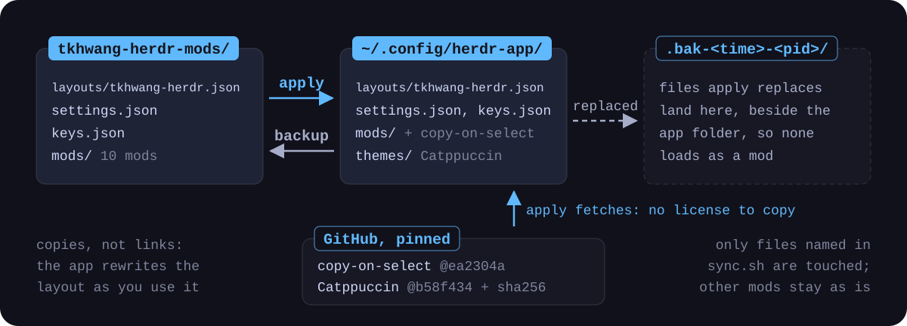

<p align="center">
  
</p>

My [Herdr app](https://herdr.dev/core/) window, as files: the `tkhwang-herdr` layout, clones of Herdr's own mods with small marked patches, and third-party mods kept with their licenses. Moved here from [tkhwang-dotfiles](https://github.com/tkhwang/tkhwang-dotfiles).

## Quick start

```bash
git clone https://github.com/tkhwang/tkhwang-herdr-mods.git
cd tkhwang-herdr-mods
./sync.sh apply
```

After a first `apply`, restart Herdr (it sees new mod folders at start) and pick the `tkhwang-herdr` layout with ⌘⇧L, or run `herdr-app do layout.switch '{"name":"tkhwang-herdr"}'`. Every file `apply` replaces is moved to `~/.config/herdr-app.bak-<time>-<pid>/` first.

## What it changes

| Where | What you get |
| --- | --- |
| **Spaces list**<br>`better-spaces` | branch and PR status per space, nested worktrees, workbranch tasks named after their repo with its branch (one repo) or their task folder with the project and only what differs (several repos), dev server ports, agent status glows (a breathing contour while an agent works, yellow where it's open on the right), a cyan current space |
| **Agents list**<br>`agents-dev` | agents grouped under their space, nested rows, workbranch tasks named as in the Spaces list, the repo an agent is in for a multi-repo task, the same glows and highlight |
| **Tab bar**<br>`tabs-dev` | yellow agent tabs, wider tabs, a **Git** button, a Markdown icon, a [1] \| [1\|2] \| [1\|2/3] window switch |
| **`+` menu**<br>`herdr-open-with-zed` | **Open with Zed** for the focused terminal's folder |
| **Side panel**<br>`files-dev`, `better-changes`, `git-graph` | Files, Changes and Git show one folder, the tab's first pane (its main window), or a pane or folder picked in the folder bar under each panel's header; the focus no longer moves them |
| **Side panel, Files**<br>`files-dev` | the previewed file feeds the Markdown icon |
| **Side panel, Changes**<br>`better-changes` | staged/unstaged groups, diffs, a repo picker in workbranch wrappers, AI commit messages, a Push button |
| **Side panel, Git**<br>`git-graph` | a commit graph, or a Manygit list in a folder of repos |
| **Center tab**<br>`markdown-browser` | a Markdown preview of the picked file |
| **Terminal**<br>copy-on-select | copies a selection on mouse release |
| **Theme**<br>Catppuccin | Mocha in dark mode, Latte in light mode, a `#60b9fc` accent |

`spaces-dev` and `changes-dev` stay installed as fallbacks: put either back in the layout's spaces or changes block to switch.

## How sync works

<p align="center">
  
</p>

```bash
./sync.sh backup   # ~/.config/herdr-app -> this repo (run after changing a mod or the layout)
./sync.sh apply    # this repo -> ~/.config/herdr-app (replaced files go to ~/.config/herdr-app.bak-<time>-<pid>/)
```

The [Herdr app](https://herdr.dev/core/) (herdr-core desktop window) keeps its layout and mods in `~/.config/herdr-app`. The customized ones live here as copies, not symlinks: the app rewrites the layout file as the window is used.

Both copy only the mods and files named in `sync.sh` (`mods`, `files`, plus copy-on-select and the Catppuccin themes on `apply`); any other mod in `~/.config/herdr-app` is neither backed up nor replaced. `apply` stages each copy beside the app folder before swapping it in, so the app never loads a partial mod. When `herdr-app` is installed, it checks every changed mod there with `herdr-app check` before any goes in; if one fails, it stops and nothing is installed.

## Before you apply

- **What runs, and what reaches the network.** `better-spaces` runs `git`, `hc` and `gh` (GitHub with your local `gh` login). The sparkle **Message** button in `better-changes` runs `claude -p`, so the staged diff goes to Anthropic through your Claude Code login, and its Push button runs `git push` with your git credentials. `git-graph` reaches the network only on Fetch, Pull, Push or deleting a remote branch, and asks GitHub's releases API once a day for a newer release. `markdown-browser` uses no network.
- **Workbranch wrappers.** In a folder of repos that is not a repo itself, `better-changes` and `changes-dev` show a repo picker, `git-graph` shows a Manygit list, and `better-spaces` and `agents-dev` name a workbranch task space (a `.workbranch.task` file beside its repos, or a folder of repos right under a project's `.workbranch.config` other than `_base`) after its repo with the branch under it when it holds one repo, and after its task folder when it holds several, since those repos are the same in every task; there `better-spaces` shows the project under the name and a repo's branch only when it isn't the task's (no PR status for a task folder). A plain folder of repos and a project's own folder keep their names.
- **Theme picks.** A theme picked in Settings > Look is kept per layout in `layouts/.state/`; pick the Catppuccin themes there again if one was picked before.
- **Command time limit.** Herdr stops a command after 30 s, so a slow fetch or push in `git-graph` can fail.

## Mods in detail

Each patch is marked with a comment, so `grep -rn "status glow" mods` finds every line of that patch.

<details>
<summary><b><code>layouts/tkhwang-herdr.json</code></b> · the window</summary>

Clone of the shipped `main` layout; its spaces block points to `better-spaces`, its agents block to `agents-dev`, its Files block to `files-dev`, its Changes slot to `better-changes`, its tab bar to `tabs-dev`, and its side panel (`panel-body`) has a third block, `graph`, for `git-graph`. Its theme is Catppuccin: `herdr-catppuccin` (Mocha) in dark mode, `herdr-catppuccin-latte` in light mode.

</details>

<details>
<summary><b><code>better-spaces</code></b> · Spaces list · <a href="https://github.com/munza/herdr-mods/tree/main/better-spaces">munza/herdr-mods</a> at <code>77d94f7</code>, patched</summary>

**Markers:** `dev ports`, `space colors`, `status glow`, `current highlight`, `wrapper repos`

[munza/herdr-mods](https://github.com/munza/herdr-mods/tree/main/better-spaces) at `77d94f7` (branch right-aligned on the space row, worktrees nested, PR status from `gh`), in the spaces block. Patched with the same `dev ports` line (`ports.js` and lines marked `dev ports`), and `updateColors` waits up to 2 s after a start for the shared `space.colors` (marked `space colors`): without that its first tick recolored every space. It runs `git`, `hc` and `gh` (GitHub with your local `gh` login). A space whose first terminal is in a workbranch task folder (not a repo: a `.workbranch.task` file beside the repos it holds, such as `feature-cpq-task-a/backend` and `feature-cpq-task-a/frontend`, or, for a task made before that file, a folder of repos right under the project's `.workbranch.config` other than its `_base`), or in a repo right in one, takes the row's width (nothing beside the name) and one dim line under it. A task of one repo is named after the repo (`tkhwang-herdr-mods`), and the line shows the repo's branch (`feat/update-1105-part2`), ahead and behind: the repo first, then the branch that says which task. A task of several repos is named after the task folder (`feature-cpq-task-a`), since its repos are the same in every task, and the line shows the project (`PROJECT_NAME` in `.workbranch.config`) and only the repos with something to say, by name: a branch other than the task's, ahead and behind. A branch other than the task's is yellow in both: the task file's `REPO_BRANCH`, else the folder name with `-` read as `/`, which is how workbranch names the folder. Every repo's branch is in that line's tooltip; the project, task and folder in the name's. A space the person named keeps its name, with the repo's name before a lone repo's branch. The tasks are published as the shared `better-spaces.wrappers` for the Agents list (marked `wrapper repos`; `TASK_INFO`, `better-changes`' repo loop behind the task check, at most 6 repos, read every 15 s while the window is active and after a command ends in the space). No PR status for a task folder.

Also merged in: the agent status glows of [filipores/herdr-spaces-status](https://github.com/filipores/herdr-spaces-status) at `4881e68` (green done, orange blocked; `navigation.js` and lines marked `status glow`; commands `better-spaces.first_done` and `better-spaces.next_working`, no keys bound), Apache-2.0 ([`LICENSE-herdr-spaces-status`](LICENSE-herdr-spaces-status), [`NOTICE-herdr-spaces-status`](NOTICE-herdr-spaces-status)). Its own `spaces-glow` mod isn't installed: it replaces the same Spaces block and would drop the branch, PR and port lines. A space where an agent works keeps the original faint neutral contour that breathes. When that agent is in the tab open on the right, the current space's contour turns yellow and stronger (`#facc15`, the tab bar's agent color; `WORKING`) over its cyan tint, so at most one row is yellow: the one you're watching. Blocked is a deeper orange (`#f97316`) than the original amber, which read as that yellow.

A space's avatar shows the first letters of its name's first and last words (`tkhwang-herdr-mods` TM, `feature-cpq-task-a` FA, `workbranch` W; marked `space initials`), as does its header in the Agents list: one letter came out the same for most spaces of one project or owner.

The active space row is tinted cyan (`#22d3ee`), with a cyan bar on the left and its name in bold (marked `current highlight`): the plain selected background looked like the status outlines, most space colors are green or teal like the done glow, and yellow sat too close to the blocked orange.

</details>

<details>
<summary><b><code>agents-dev</code></b> · Agents list · clone of Herdr's <code>agents</code> 0.1.11</summary>

**Markers:** `space headers`, `status glow`, `current highlight`, `nested rows`, `wrapper repos`

"Grouped by space" headers with the space's colored initials (as the Spaces list draws them; marked `space initials`), bold name and separators, without ahead, behind or PRs (the Spaces list shows a space's git state, the Agents list who works where); patch marked `space headers`. Until a sort is picked it groups by space (the shipped default is Priority, which has no space headers); the pick is kept by the app, not in this repo.

Each agent row also gets the Spaces list's status glow (green done, orange blocked, a breathing contour while working, yellow when the agent is in the tab open on the right; marked `status glow`), and the focused agent's row the same cyan highlight (marked `current highlight`).

Under a space header each agent row, and its sub-terminal rows, steps in 22px (the header's avatar and gap, the depth the Spaces list nests a worktree at), so the space reads as the heading and its agents as the items under it; pinned and priority rows, which name their space themselves, stay at the edge (marked `nested rows`; the `NEST` constant sets the depth).

A workbranch task space's header is named and lettered as in the Spaces list: a task of one repo after the repo, with its branch on a line under the name (it says which task), a task of several after its task folder; in a task of several repos an agent's row names the repo its folder is in (`backend`; nothing at the task's own folder), read from `better-spaces`' shared `better-spaces.wrappers` (marked `wrapper repos`).

</details>

<details>
<summary><b><code>tabs-dev</code></b> · tab bar · clone of Herdr's <code>tabs</code> 0.1.11</summary>

**Markers:** `open with zed`, `tab width`, `tab kind`, `git graph`, `markdown browser`, `view mode`

Clone of the shipped tab bar whose `+` button opens `herdr-open-with-zed` (one row taller, 543px); patch marked `open with zed`. Each tab is at least 180px wide, so a short name is still easy to click, with the status dot and close button at its right edge (marked `tab width`).

A tab with an agent in any of its panes is tinted yellow (`#facc15`), the color that stands out most since agent tabs matter most, while other tabs keep the theme's grey and are always outlined in the theme's foreground at 25% (40% when active, also filled), since the shipped tab bar draws inactive tabs as bare text and the theme's own border color almost vanishes against the bar (marked `tab kind`).

A **Git** button beside Files and Changes opens `git-graph` in the same side panel (marked `git graph`; the panel's `graph` block is in `layouts/tkhwang-herdr.json`).

A Markdown icon after **Git**, past a thin line (an icon alone, since it is used less than Files, Changes and Git; its tooltip names it), renders the Markdown file the open panel is on (Files' preview, or the file picked in Changes) in a `markdown-browser` tab in the center, one per space, switched in place on the next click and lit while that tab is shown; it stays dim until a Markdown file is picked (marked `markdown browser`; `markdown.js`, shared `markdown-tab.tabs`, `markdown-browser.show` and `markdown-browser.slots`).

Right of `+`, a [1] | [1|2] | [1|2/3] switch for a tab's main window, its first pane, and its secondary windows: each button is a small picture of the windows it shows, numbered as the folder bar numbers them. 1 zooms the main window so the secondary ones fold away, still running, and the file panel keeps its room, also when switching tabs and when an agent starting or ending in the shown tab changes whether it folds. 2 shows them side by side, and a click on 2 in a tab with only its main window splits it down the middle for a secondary shell in main's folder. 3 shows main and two secondary windows stacked on its right, and a click on 3 makes the ones a tab lacks: main alone is split down the middle, then the second window is split across for a third, each a shell in main's folder; a tab of two gets only the third. 2 puts a tab's third window away instead of closing it: its terminal keeps running without a pane (`terminal.park`), and 3 puts that same shell back under the second window (`terminal.keep`), so 3 → 2 → 3 keeps its history; a new one is made only when there is none to put back. A third window running an agent stays in view, since put away its status would leave the tab and the agent lists. Like 1's folding, putting away and back also happens when switching tabs, never on a split or an agent starting; closing a tab ends the shells put away from it. 1 folds a tab with an agent, or one of main and one or two secondary windows (what 2 and 3 make); one with more windows and no agent (`herdr-dev.sh`'s four-pane dev tab) keeps them all, and a zoom 1 left there comes undone when it is shown. On their own the modes never touch a zoom done by hand, and a pane split in while a tab is folded stays in view. A click on any button, the lit one too, puts the shown tab in that mode: 2 and 3 unzoom any pane, and 1 folds the tab to its main window, moving a zoom done by hand (marked `view mode`; shared `tabs-dev.view`, `tabs-dev.view-zoomed` and `tabs-dev.view-parked`).

</details>

<details>
<summary><b><code>herdr-open-with-zed</code></b> · <code>+</code> menu · <a href="https://github.com/atleugim/herdr-open-with-zed">atleugim/herdr-open-with-zed</a> at <code>a15570e</code>, unchanged</summary>

[atleugim/herdr-open-with-zed](https://github.com/atleugim/herdr-open-with-zed) at `a15570e`, unchanged: Herdr's `+` menu (`new-menu` 0.1.11) with an **Open with Zed** row that opens the focused terminal's folder in Zed (`zed`, else `zeditor`, else `open -a Zed`). Apache-2.0 ([`LICENSE-herdr-open-with-zed`](LICENSE-herdr-open-with-zed)); after a Herdr update changes `new-menu`, copy its `main.js` again and re-add the row.

</details>

<details>
<summary><b><code>files-dev</code></b> · side panel, Files · clone of Herdr's <code>files</code> 0.1.13</summary>

**Markers:** `markdown tab`, `panel folder`

Clone of the shipped Files panel (0.1.13). It publishes the file its preview shows as the shared `files-dev.shown`, so the tab bar's Markdown icon can render it, and while that Markdown viewer tab is the shown one it keeps listing the folder the file came from instead of jumping to the space folder (marked `markdown tab`; `markdown.js` is the same file as in `tabs-dev`).

It lists the folder Changes and Git show too, with the folder bar under its header, instead of the focused pane's, and in the Changes diff tab it stays on the diff's repository (marked `panel folder`; `panel-folder.js`, below).

</details>

<details>
<summary><b><code>better-changes</code></b> · side panel, Changes · <a href="https://github.com/munza/herdr-mods/tree/main/better-changes">munza/herdr-mods</a> at <code>77d94f7</code>, patched</summary>

**Markers:** `wrapper repos`, `commit box`, `ai message`, `push button`, `markdown tab`, `panel folder`

[munza/herdr-mods](https://github.com/munza/herdr-mods/tree/main/better-changes) at `77d94f7` (staged/unstaged groups with stage buttons, tree/flat list, inline/side-by-side diff in one reusable tab), in the Changes slot. Patched with the same `wrapper repos` repo picker (it commits staged changes of the picked repo only), and `mod.json` `place` is `none` so it doesn't also dock a second right sidebar. The commit message is a text area (3 to 8 rows) with the buttons under it, Message, Commit and Push filling the row 1 : 2 : 1 (marked `commit box`; `BUTTON_WEIGHTS` at the top of `main.js`). They keep their look while the panel rereads git (every 10 s and on every file change), and a press during that runs as soon as it ends (`whenLoaded`).

A sparkle **Message** button left of Commit asks an AI for the message from the staged diff and the last 8 commit messages, keeping the repo's prefix form and language (marked `ai message`; `sparkle.svg`, `AI_COMMAND` and `AI_EXAMPLES` at the top of `main.js`, `aiPrompt` and `aiMessage` in `model.js`): it runs `claude -p` with no tools and the `sonnet` model, so the staged diff goes to Anthropic through your Claude Code login; change `AI_COMMAND` for codex or grok.

A **Push** button right of Commit sends HEAD to its upstream branch, showing how many commits it is ahead as of the last fetch (`Push ↑2`); a branch with no upstream goes to its remote (else `origin`, else the only remote) under its own name and is tracked from then on (marked `push button`; `push.svg`, `pushTarget` and `pushHead` in `main.js`). It turns solid when there is something to push and nothing staged to commit. It never forces: a push the remote rejects shows git's reason as a note. It is off on a detached HEAD, with no remote, or when the upstream is another local branch. It runs `git push` with your git credentials, and Herdr stops it after 30 s like any command.

`markdown.js` (marked `markdown tab`, the same file as in `tabs-dev`) keeps the panel on the repo it was on while the Markdown viewer tab is shown. `changes-dev` stays installed: put it back in the layout's `changes` block to switch.

It reads the folder Files and Git show too, with the folder bar under its header, instead of the focused pane's; in a workbranch wrapper the repo picker stays under the folder bar (marked `panel folder`; `panel-folder.js`, below).

</details>

<details>
<summary><b><code>git-graph</code></b> · side panel, Git · <a href="https://github.com/rabeeh-ta/herdr-git-graph">rabeeh-ta/herdr-git-graph</a> at <code>2226f57</code> (v0.3.0), patched</summary>

**Markers:** `review fixes`, `panel folder`

[rabeeh-ta/herdr-git-graph](https://github.com/rabeeh-ta/herdr-git-graph) at `2226f57` (v0.3.0): a commit graph of the focused terminal's repository after VS Code's Git Graph (colored lanes, branch/remote/tag labels, an uncommitted row, commit details and diffs; double-click a branch to check it out, right-click for checkout, merge, rebase, cherry pick, revert, reset, tag, branch, push, commit and stash, each asking first in a dialog), and in a folder of repositories (a workbranch wrapper) a Manygit list of them with branch, uncommitted count and ahead/behind. Opened from the tab bar's **Git** button into the side panel's `graph` block.

Patched with six fixes from this repo's review (marked `review fixes`):
- Non-ASCII file names stay raw (`core.quotePath=false` in `READ`), so their diffs open.
- A new, untracked file's diff shows its contents.
- A `git add` refreshes the uncommitted row, and with it the Commit dialog's "Stage every change" default.
- Fetch, pull and push from the menus run with prompts off, like its background fetch.
- A dialog stays open while its action runs.
- The menu's first item can't be started twice.

In the side panel it shows the folder Files and Changes show, with the folder bar under its header, instead of the focused terminal's, and its hints for a folder without a repository point at that bar; opened as a pane with a folder it keeps that folder (marked `panel folder`; `panel-folder.js`, below).

It runs `git`, and for Manygit `find` and `env`; git reaches the network only on Fetch, Fetch all, Pull, Push or deleting a remote branch, and the mod itself asks GitHub's public releases API once a day for a newer release (**Stop checking** in its update window, or `CHECK = false` in `update.js`, turns that off). Herdr stops a command after 30 s, so a slow fetch or push can fail there.

MIT ([`LICENSE-herdr-git-graph`](LICENSE-herdr-git-graph)); its icons follow Lucide, ISC (`mods/git-graph/icons/LICENSE-lucide.txt`). To update it, copy `mods/git-graph/` from that repo again, then re-apply the `panel folder` lines and the `review fixes` lines that the new release doesn't already cover.

</details>

<details>
<summary><b><code>panel-folder.js</code></b> · one folder for Files, Changes and Git</summary>

**Marker:** `panel folder`, in `files-dev`, `better-changes` and `git-graph`

The shipped panels follow the focused pane, each on its own, so a click on a second or third pane, or the tab bar's view switch moving the focus, moved Files, Changes and Git to other folders. The three now show one folder for the shown tab, whatever has the focus: its main window's, the tab's first pane, which the tab bar's 1 shows.

A folder bar under each panel's header has a chip for each folder the tab's panes are in, numbered by the first pane there and with its branch, and **Folder…**, which picks any folder on this machine in the system's folder picker (not in a space on another machine). The lit chip is the folder all three show. A click on another chip lights it in all three for that tab, until another pick: a picked pane is followed as it changes folder, and once it closes the main pane is back. Picks are kept by tab in the shared `panel-folder.picks`. The Changes diff tab and the Markdown viewer tab have no bar and keep the folder they were opened from.

Herdr can list an agent's terminal in a folder other than the one the agent works in; **Folder…** shows the right one then. The same file lives in all three mods: change the copies together.

</details>

<details>
<summary><b><code>markdown-browser</code></b> · center tab · <a href="https://github.com/ohneda/herdr-markdown-browser">ohneda/herdr-markdown-browser</a> at <code>bb1f3c7</code>, <code>place</code> changed</summary>

[ohneda/herdr-markdown-browser](https://github.com/ohneda/herdr-markdown-browser) at `bb1f3c7`: a native Markdown preview pane (Herdr's `TextView.markdown`, so no images or Mermaid), reloaded when the file changes, with a **Default app** button and `⌘⇧O` (its `mod:markdown-browser` section is merged into `keys.json`) for the system's default `.md` app. Used here only as the viewer the tab bar's Markdown icon opens; its own Markdown list panel isn't in the layout. The one change: `mod.json` `place` is `none`, so it doesn't dock a column at the window's right edge.

It reads the previewed file and watches its folder; opening in the default app runs `sh` with `realpath` and `open`; its list (unused here) would run `git rev-parse`, `git ls-files` or `find`; no network. MIT ([`LICENSE-herdr-markdown-browser`](LICENSE-herdr-markdown-browser)). To update it, copy `mods/markdown-browser/` from that repo again and set `place` to `none`.

</details>

<details>
<summary><b><code>spaces-dev</code></b> · fallback Spaces list · clone of Herdr's <code>spaces</code> 0.1.11</summary>

**Markers:** `dev ports`

Dev server ports under each space (`🧑 fe:3011 · be:5010`, `🤖` for agent-started servers), read from the files `herdr-dev.sh watch` writes (see [`scripts/projects/fullstack-multi-repo/`](https://github.com/tkhwang/tkhwang-dotfiles/tree/main/scripts/projects/fullstack-multi-repo) in tkhwang-dotfiles); patch: `ports.js` and lines marked `dev ports`. Replaced in the layout by `better-spaces` and kept as the fallback.

</details>

<details>
<summary><b><code>changes-dev</code></b> · fallback Changes panel · clone of Herdr's <code>changes</code> 0.1.11</summary>

**Markers:** `wrapper repos`

In a workbranch wrapper folder (not a repo, repos right under it such as `backend/` and `frontend/`) a repo picker with per-repo change counts; commits go to the picked repo; patch marked `wrapper repos`. Unlike `better-changes` it follows the focused pane, not the folder bar.

</details>

<details>
<summary><b><code>settings.json</code>, <code>keys.json</code></b> · app look and keys</summary>

App look and keys; `keys.json` also carries markdown-browser's `mod:markdown-browser` section (`⌘⇧O`).

</details>

<details>
<summary><b>copy-on-select</b> · terminal · downloaded by <code>apply</code></summary>

[jspoynor/herdr-copy-on-select](https://github.com/jspoynor/herdr-copy-on-select) copies a terminal selection on mouse release; it has no license, so `apply` downloads it at a pinned commit instead of keeping a copy here.

</details>

<details>
<summary><b>Catppuccin themes</b> · theme · downloaded by <code>apply</code></summary>

[MarcozVD/herdr-layout-catppuccin](https://github.com/MarcozVD/herdr-layout-catppuccin): `themes/herdr-catppuccin.json` and `themes/herdr-catppuccin-latte.json`, with a sky-blue `#60b9fc` accent; no license, so `apply` downloads them at `b58f434` and checks each sha256. Only the themes: that repo's `catppuccin` layout swaps the tab bar, spaces, agents and changes blocks for its own mods, which would drop the patches above. A theme picked in Settings > Look is kept per layout in `layouts/.state/`; pick the Catppuccin themes there again if one was picked before.

</details>

## Updating

The `-dev` mods are `mod.clone`s of Herdr's own mods (version 0.1.11, `files-dev` 0.1.13, recorded as `cloned_from` in each `mod.json`), licensed Apache-2.0 ([`LICENSE-herdr`](LICENSE-herdr)). Clones get no Herdr updates: after an update changes a shipped mod, clone it again and re-apply the marked patch. `markdown.js` is one file kept in `tabs-dev`, `files-dev` and `better-changes`: change all three together. `panel-folder.js` likewise is one file kept in `files-dev`, `better-changes` and `git-graph`.

`better-changes` and `better-spaces` are Apache-2.0 ([`LICENSE-herdr-mods`](LICENSE-herdr-mods), [`NOTICE-herdr-mods`](NOTICE-herdr-mods)). To update one, copy `<name>/mods/<name>/` from that repo and re-apply its marked patch (and for `better-changes` the `place` change).

## Licenses

| Code | From | License |
| --- | --- | --- |
| `agents-dev`, `changes-dev`, `files-dev`, `spaces-dev`, `tabs-dev` | Herdr's own mods | Apache-2.0, [`LICENSE-herdr`](LICENSE-herdr) |
| `better-spaces`, `better-changes` | [munza/herdr-mods](https://github.com/munza/herdr-mods) | Apache-2.0, [`LICENSE-herdr-mods`](LICENSE-herdr-mods), [`NOTICE-herdr-mods`](NOTICE-herdr-mods) |
| status glows in `better-spaces` | [filipores/herdr-spaces-status](https://github.com/filipores/herdr-spaces-status) | Apache-2.0, [`LICENSE-herdr-spaces-status`](LICENSE-herdr-spaces-status), [`NOTICE-herdr-spaces-status`](NOTICE-herdr-spaces-status) |
| `herdr-open-with-zed` | [atleugim/herdr-open-with-zed](https://github.com/atleugim/herdr-open-with-zed) | Apache-2.0, [`LICENSE-herdr-open-with-zed`](LICENSE-herdr-open-with-zed) |
| `git-graph` | [rabeeh-ta/herdr-git-graph](https://github.com/rabeeh-ta/herdr-git-graph) | MIT, [`LICENSE-herdr-git-graph`](LICENSE-herdr-git-graph); icons Lucide, ISC |
| `markdown-browser` | [ohneda/herdr-markdown-browser](https://github.com/ohneda/herdr-markdown-browser) | MIT, [`LICENSE-herdr-markdown-browser`](LICENSE-herdr-markdown-browser) |
| copy-on-select | [jspoynor/herdr-copy-on-select](https://github.com/jspoynor/herdr-copy-on-select) | none, so not kept here: `apply` downloads it |
| Catppuccin themes | [MarcozVD/herdr-layout-catppuccin](https://github.com/MarcozVD/herdr-layout-catppuccin) | none, so not kept here: `apply` downloads them |
